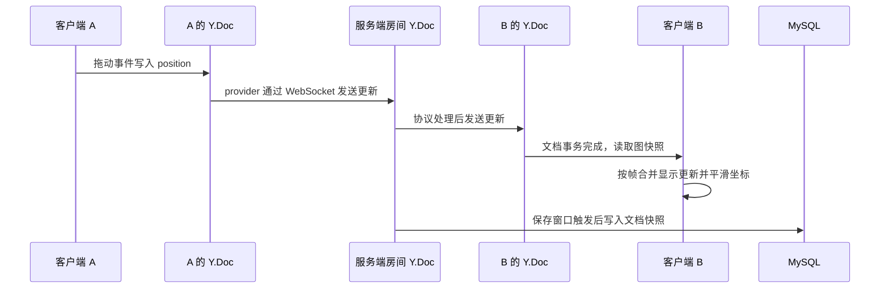

# Flowboard 中的 WebSocket：从建立连接到同步白板

做实时协作白板时，最容易混在一起的是几件不同的事：连接建立了、数据发出去了、对方文档更新了、画面显示出来了、数据库保存成功了。它们不是同一个状态，也不由同一个库负责。

这篇记录沿着 Flowboard 的实际实现，把这些环节串起来。项目基于 Vue Flow、Yjs、y-websocket、Node.js 和 MySQL；以下代码与行为以 2026-10-24 的实现为准。它是单进程、按房间协作的白板，不是完整的账号权限系统，也没有实现多实例部署。

## 先把几个对象分开

| 对象 | 负责什么 | 不负责什么 |
| --- | --- | --- |
| Vue Flow | 节点、连线与拖动等画布交互 | 自动把业务数据同步到其他设备 |
| Y.Doc | 保存可合并的共享数据，产生和应用更新 | 建立网络连接、自动写入 MySQL |
| WebsocketProvider | 在本地文档与服务端之间交换同步消息，并维护连接 | 判断房间业务权限、保证数据已经落库 |
| 服务端的 WebSocket 连接 | 收发协议消息 | 自带房间、用户或订单等业务概念 |
| Awareness | 在线成员、光标、正在操作哪些节点等临时状态 | 可靠锁、登录身份、长期数据保存 |
| MySQL | 保存房间资料与 Yjs 文档快照 | 驱动画布的每一帧动画 |

WebSocket 本身不要求有“共享文档”。聊天应用完全可以通过它收发 JSON 消息，再由服务端校验、存储和转发。Flowboard 选择 Yjs，是为了让多个客户端的共享状态能够合并；共享文档是这套协作方案的选择，不是 WebSocket 的规定。

本项目采用客户端连接中心服务端的方式。发送和接收通过事件回调处理，不需要前端不断请求“有没有新消息”。心跳、重连计时器仍然存在，但它们不等于用轮询获取业务更新。

## 1. 建房、查房和建立连接是三件事

新建白板先调用 HTTP 接口，把房间资料和初始文档写入数据库，拿到房间 ID 后再进入协作连接流程。加入已有房间则先查询房间，让页面可以明确显示“房间不存在”等错误。

这个查询只是提前反馈。查询成功到真正建立 WebSocket 连接之间，房间仍可能被删除，所以服务端在握手阶段必须再检查一次，不能只相信首页查过了。

```text
创建房间：POST /api/rooms → 写入数据库 → 返回房间 ID 与管理凭证
加入房间：GET /api/rooms/:id → 确认房间信息
建立协作连接：WebSocket 握手 → 再次校验 → 加载文档 → 接受连接
```

这里的 `/api` 是后端路径。线上浏览器访问的是 `/flowboard/api/`，由 Nginx 转发并改写路径。

### `upgrade` 中的 req、socket、head 分别是什么

```js
server.on('upgrade', (request, socket, head) => {
  // 检查房间与服务状态，满足条件后交给 wss.handleUpgrade。
})
```

这是当前项目采用的 HTTP/1.1 升级方式。客户端虽然使用 `ws://` 地址发起连接，最初发送的仍是带升级请求头的 HTTP 请求。服务端接受后返回 `101 Switching Protocols`，此后这条连接传输 WebSocket 帧。

| 参数 | 含义 |
| --- | --- |
| `request` | 握手时的 `http.IncomingMessage`，可读取 `url`、`method`、`headers` 等 |
| `socket` | 承载连接的底层双工流；当前明文 HTTP 服务中是 TCP socket |
| `head` | HTTP 解析后已读到的后续数据，可能为空；应交给 `handleUpgrade` 继续处理 |

`request` 不是每一条后续编辑消息，也没有自动生成的 `roomId` 属性。普通服务端收到的 `request.url` 通常是路径与查询字符串，不是完整的 `ws://主机/路径`。

例如浏览器连接：

```text
ws://服务器/flowboard/ws/room-123?example=1
```

经过当前 Nginx 的 `/flowboard/ws/` 转发规则后，Node 端读取到的请求路径是：

```text
/room-123?example=1
```

当前后端用下面的方式取房间号，外围还有异常捕获与 ID 格式校验：

```js
const id = decodeURIComponent(
  new URL(request.url, 'http://localhost').pathname.slice(1),
)
```

其中 `http://localhost` 只是解析相对 URL 所需的基准，不会发出一次访问 localhost 的请求。路径来自实际到达 Node 的请求，不能忽略代理是否移除了前缀。

校验失败时，直接在 socket 上写出 HTTP 错误响应并结束连接，不再调用 `handleUpgrade`。不需要把 `request` 清空后交给库：清空对象既不表示拒绝，也不能阻止后续处理。

## 2. setupWSConnection 不是一个远程黑盒

最初容易把它理解成“把 ws 和 req 交给库，库负责广播”。实际更具体：这个函数就在 Node 进程里运行，取得房间文档，把连接加入文档的连接集合，并注册消息、关闭及心跳等处理逻辑。

项目调用方式是：

```js
setupWSConnection(ws, request, { docName: entry.id })
```

显式传入 `docName`，让协议层使用业务代码已经校验过的房间 ID。

当前安装版本的库包含这样的核心逻辑：

```js
conn.on('message', message => {
  messageListener(conn, doc, new Uint8Array(message))
})
```

收到同步消息后，库解析协议并将相应更新应用到服务端 Y.Doc；服务端文档的更新处理再负责向连接发送更新。Awareness 消息走另一种协议消息类型。连接刚建立时，还会交换同步所需的信息，而不是只等待客户端第一次拖动。

因此服务端并非只有透明转发：**当前方案中，服务端也持有每个活动房间的文档。**各客户端各有一份 Y.Doc，它们不是跨进程共享的同一块内存，而是靠交换更新逐步一致。

接管后仍然可以写自己的 Node 业务代码，HTTP 接口也不会因为某个客户端建立了 WebSocket 而失效。但不能误以为另加一个 `ws.on('message')` 就能拦截库的监听器。多个监听器都会有机会执行；你在其中一个函数里 `return`，不会取消另一个监听器的写入。

如果以后要做只读角色，应当在应用更新之前设计授权边界，使用支持该能力的服务端接入层，或明确接管协议处理。不能等共享文档已经被修改后，只靠“不广播”补救，更不应该直接修改 node_modules 作为长期方案。

## 3. 一次拖动怎样到达另一个窗口



这是单次更新的简化链路，省略了握手、初始同步和其他客户端。

### 写入共享结构，不是只修改 Vue 数组

当前节点结构可以理解成：

```text
Y.Doc
├─ nodes: Y.Map
│  └─ nodeId: Y.Map
│     ├─ position: 普通对象 { x, y }
│     └─ data: Y.Map
│        ├─ label: string
│        ├─ content: string
│        └─ color: string
└─ edges: Y.Map
   └─ edgeId: 连线对象
```

拖动事件调用 `session.updatePositions()`，最终通过 `Y.Map.set()` 更新共享坐标。不是拿出普通对象后改 `position.x` 就能自动同步，也不是用了 Vue Flow 的 `v-model` 就自动具备网络协作能力。

当前坐标是整体写入的：

```js
node.set('position', { ...position })
```

因此本项目的远端跳动不能直接归因于“先发 x，再发 y”。标题、正文、颜色则拆成嵌套 Y.Map 的不同键，减少修改不同字段时互相覆盖的范围。

这仍然有边界：标题和正文是字符串，并没有使用 `Y.Text`。两个客户端并发覆盖同一个字符串字段时，Yjs 能让副本按规则收敛，但不能保证把两个人的文字意图都保留下来。CRDT 解决的是副本合并问题，不自动解决所有业务冲突。

### 监听文档变化，再转换成显示数据

早期实现讨论过 `observe`，最终代码使用文档的 `afterTransaction`，检查节点或连线是否发生变化，再生成图快照交给组件。事务既可能来自本地编辑，也可能来自远端更新，不能把所有回调都当成别人发来的消息。

项目通过事务的 `origin` 区分本地操作与远端变化，并只跟踪指定来源的撤销记录。读快照和写共享结构也分开：渲染回调读取结果，不把每次显示刷新再写回文档。

`doc.getMap('nodes')` 只是取得当前文档中的共享结构。它不是数据库查询，也不会独立下载房间数据。网络交换由 provider 完成，持久化加载由服务端业务代码完成。

## 4. 光标为什么不和节点坐标放在一起

节点位置属于白板内容，关闭页面后再次打开仍应恢复。光标位置、正在编辑哪个节点属于当前客户端状态，离线后应消失，不值得写进长期快照。

项目使用 `provider.awareness` 维护这些字段：

```js
awareness.setLocalState({
  user: { name: nickname },
  editingNodeId: null,
  draggingNodeIds: [],
  cursor: null,
})
```

这几个字段是应用自己定义的，并非库规定必须存在的属性。通过 `getStates()` 可以读取 `clientID → 状态对象` 的映射；`clientID` 标识文档客户端实例，不是账号 ID、房间 ID，也不是永远不变的用户身份。同一个人开两个客户端会有两个状态，这样关闭其中一个不会错误地把另一个也视为离线。

Awareness 与文档同步可以共用一条 WebSocket 连接，但它不是另一个保存业务内容的 Y.Doc。其状态会被传播和清理；异常断网的消失可能需要等待检测，不是关掉窗口后所有人立刻得知。

项目根据这些状态提示谁在编辑，并在正常界面操作中阻止部分误删。但这只是协作提示，不能作为安全锁：状态传播有延迟，客户端也可以伪造自己的字段。Awareness 里出现 `owner: true` 并不会获得可信权限。

## 5. 收到就渲染，为什么仍然看起来卡

这个项目里出现过两种不同的表现，不能混成一个原因。

- 本地拖动像一格一格地跳：早期启用了网格吸附，这是交互设置，不等于帧率下降。
- 本地顺滑、另一端跳动：对方看到的是离散到达的坐标目标，显示节奏可能不均匀。

WebSocket 在同一有效连接内维持消息顺序，但并不保证每隔固定时间送来一个坐标，也不保证消息刚好赶上浏览器的一帧。若显示位置直接从 P1 跳到 P2，再停一小段时间后跳到 P3，即使最终坐标正确，观感仍可能不连续。

当前优化分两步：

1. **按帧合并显示更新。** 远端快照到达时，保留最新快照；下一次 `requestAnimationFrame` 执行时处理。文档更新照常合并，不丢弃 Yjs 更新，只省略同一帧内不必逐个显示的中间状态。
2. **在显示层插值。** 从当前显示位置向最新目标位置做约 70ms 的线性过渡；新目标到来后，从当前显示位置重新出发。结束时落在精确目标坐标。

```text
共享文档：记录当前已知目标位置
显示动画：决定这一帧画在哪个位置
```

只做第一步可以减少重复渲染，但不能补出消息空隙中的运动；第二步改善连续性，同时引入一点跟随延迟。70ms 是当前实现的体验取舍，不是网络往返延迟的测量结果。

动画坐标绝不能写回 Y.Doc，否则会把显示过渡变成新的协作编辑。自己开始拖动、节点删除或页面销毁时，也要停止相应动画。本地操作直接响应，不必跟着远端显示过渡走。

本次调整后的双端实际体验有改善，但没有做系统的延迟分布或帧率压测，所以不写“优化了百分之多少”。以后遇到类似问题，可以依次观察发送频率、Network 中的消息到达节奏、文档回调次数和 Performance 主线程耗时。先定位问题在哪一段，再决定是否节流或插值。

## 6. 为什么拒绝握手后仍要处理 socket 错误

早期拒绝不存在房间的连接时，代码调用 `socket.end(...)` 后就返回了。审查指出：如果对端在这一过程中突然断开，底层 socket 仍可能异步触发 `error`。

`end()` 表示结束可写端，并不表示对象已经立刻销毁，也不表示所有网络事件都处理完毕。回调函数返回，同样不代表连接生命周期已经结束。

Node 的 EventEmitter 对未监听的 `error` 有特殊处理：它会抛出异常，未被捕获时可能终止进程。进入库的正常升级路径与自己提前拒绝的路径，不一定具有相同的错误监听器。

所以当前代码在升级回调开始处就注册：

```js
socket.on('error', () => socket.destroy())
```

这负责清理已经发生错误的连接，避免拒绝分支留下未处理的错误。它不是所有错误的通用解决方案：业务异常仍需返回明确结果，必要日志仍应保留，不能靠全局吞掉异常维持一个未知状态的进程。

这个问题由审查和复现反馈推动修复。最有用的经验是：**正常路径交给库，不代表提前返回路径也已经被库接管。**

## 7. 连接、同步、保存成功不能共用一个标志

| 状态 | 能说明什么 | 不能说明什么 |
| --- | --- | --- |
| `connected` | 当前 WebSocket 已建立 | 房间内容已全部显示、数据已保存 |
| provider 的 `sync` 状态 | 同步协议已完成相应初始同步步骤 | 后续所有修改都已经落库 |
| 数据库保存成功 | 对应版本的快照写入成功 | 此后新发生的更新也被保存了 |

服务端收到更新后，不等待 MySQL 写入完成才把消息发给其他客户端。当前实现从首次变化起安排一个默认 2 秒的保存窗口，窗口内后续拖动不会无限推迟保存；同一房间的保存串行执行，并记录已保存版本。

数据库里存的是 `Y.encodeStateAsUpdate(doc)` 编码得到的完整文档状态，而不是每个动画帧的坐标，也不只是用于显示的节点 JSON。这保留了 Yjs 恢复和后续合并所需的状态。JSON 导出则是业务层快照，用于创建一个独立的新房间，两者用途不同。

最后一个连接退出后，还要考虑正在进入的连接、在途保存和未保存变化。不能一看到连接数归零就直接销毁文档。当前运行时负责加载、保存与释放的顺序；保存失败时有限重试，保留未保存的内存状态并反馈错误。

刷新浏览器会重新创建组件与文档。刷新后仍看见旧坐标，不是原标签页的 JS 内存没有消失，而可能是新会话从服务端恢复到了原来的内容。只测刷新不足以证明数据库持久化；这个项目还做过后端正常重启后由新客户端恢复文档的检查。它不等于已验证断电、强杀进程或数据库故障恢复。

## 8. 当前权限的边界

房间号负责定位房间，不是账号。随机 ID 可以降低偶然碰到房间的概率，却不等于访问授权：链接仍然可以被分享。

当前实现允许知道有效房间链接的人协作编辑。创建者取得随机管理 token，浏览器保存在 localStorage；服务端只保存其哈希，删除房间时通过 HTTP 请求校验。Awareness 昵称不参与授权。

删除也不能只删数据库一行：还要阻止新的写入、等待在途保存、关闭在线连接并通知前端停止重连。存储层保存使用带版本条件的 UPDATE，不使用能重新插入房间的 UPSERT，避免迟到的保存重建已删除的房间。

这些措施控制的是房间删除和生命周期，不是完整的读写角色权限。若将来增加只读用户，必须在更新应用前拒绝未授权内容；仅隐藏前端按钮或者应用后不广播都不够。客户端已产生的未授权 CRDT 更新也不能靠简单反向赋值当作可靠回退，需另行设计恢复权威状态、保留草稿和重新建立会话的流程。

当前演示使用 HTTP，管理凭证没有传输加密，也没有账号绑定和找回机制。这是演示项目的明确边界，不能包装成完整安全方案。

## 排错时按这条顺序检查

1. **房间接口是否成功？** 区分不存在、接口错误与握手失败。
2. **WebSocket 是否升级成功？** 检查实际请求路径和代理改写，不猜 `req.url`。
3. **双方连接的房间是否一致？** 本项目显式传 `docName`；provider 还配置了 `disableBc: true`，让同步统一经过服务端，避免同浏览器标签页直接通信干扰判断。
4. **本地操作有没有真正写入 Yjs 共享结构？** Vue 数组变了不代表文档变了。
5. **远端文档变了吗？** 变了但画面没变，继续查快照、响应式数据及渲染；没变就查协议消息和连接。
6. **只是显示不连续，还是数据真的丢了？** 不要把动画观感、网络延迟和落库失败混为一谈。
7. **离开后资源有没有清理？** provider、文档监听器、Awareness、定时器与动画分别有自己的生命周期。

理解这条链路后，再看具体 API 就容易知道该在哪一层处理问题。WebSocket 是传输通道，Yjs 提供合并机制，房间规则和生命周期仍然需要应用自己定义。

## 对照代码与资料

项目代码以实际安装依赖和以下模块为依据，链接指向主分支，后续实现可能变化：

- [握手与房间接口：server.js](https://github.com/hgao2930-cloud/flowboard/blob/main/backend/src/server.js)
- [服务端文档生命周期：room-runtime.js](https://github.com/hgao2930-cloud/flowboard/blob/main/backend/src/room-runtime.js)
- [共享数据结构：document.ts](https://github.com/hgao2930-cloud/flowboard/blob/main/frontend/src/collaboration/document.ts)
- [连接与在线状态：session.ts](https://github.com/hgao2930-cloud/flowboard/blob/main/frontend/src/collaboration/session.ts)
- [画布更新：BoardView.vue](https://github.com/hgao2930-cloud/flowboard/blob/main/frontend/src/views/BoardView.vue)
- [远端显示插值：remoteMotion.ts](https://github.com/hgao2930-cloud/flowboard/blob/main/frontend/src/collaboration/remoteMotion.ts)

协议与 API 参考：

- [Node.js HTTP：Server upgrade 事件](https://nodejs.org/api/http.html#event-upgrade_1)
- [Node.js Events：error 事件](https://nodejs.org/api/events.html#error-events)
- [Yjs：WebsocketProvider](https://docs.yjs.dev/ecosystem/connection-provider/y-websocket)
- [Yjs：Awareness](https://docs.yjs.dev/api/about-awareness)
- [Yjs：共享文档更新](https://docs.yjs.dev/api/document-updates)

本文结合项目代码与开发讨论整理，使用 AI 辅助核对和组织文字；实际体验结果与尚未完成的验证分开记录。
